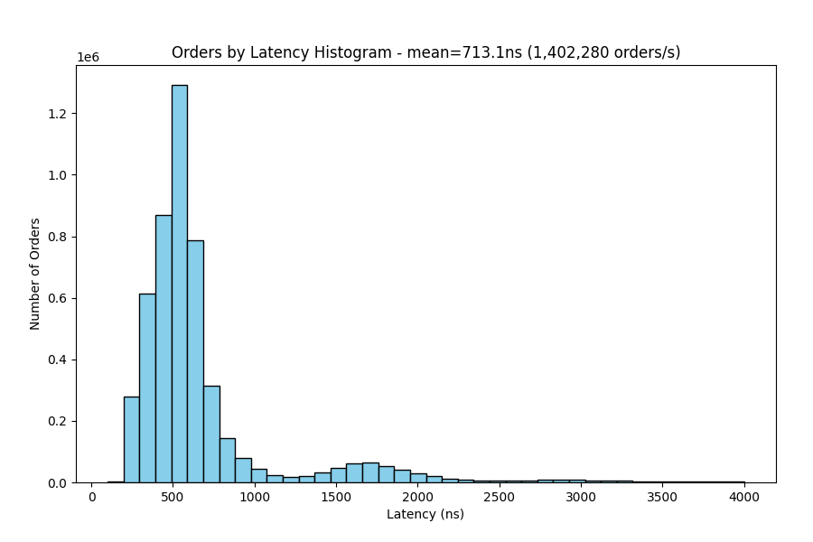
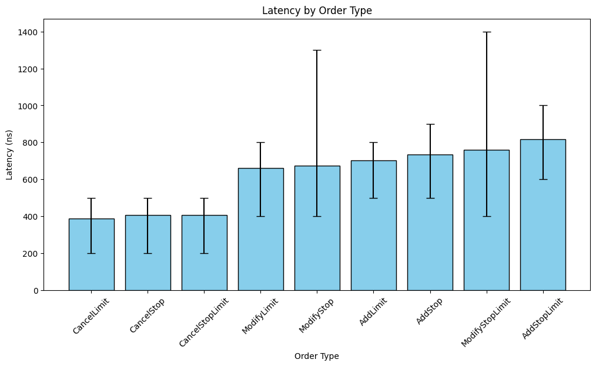
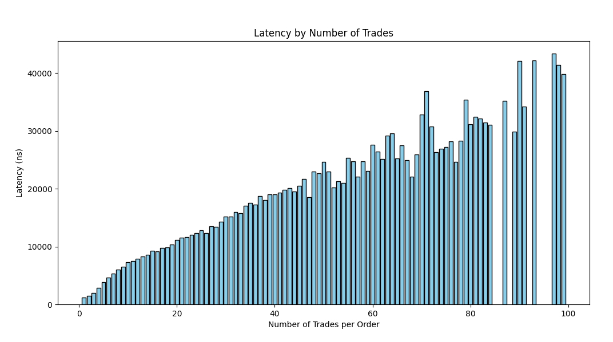
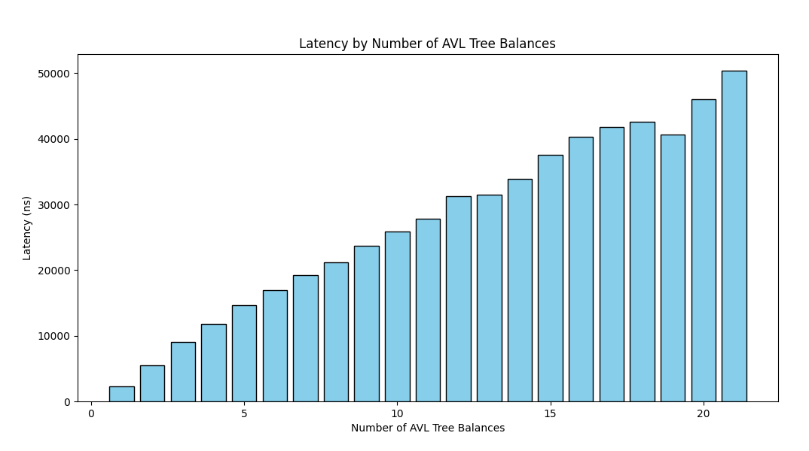

# Limit Order Book

A limit order book and matching engine written in C++ from scratch. FIFO with price priority, supporting market, limit, stop and stop-limit orders. Sustains ~1.4M orders/s on a 5M-request synthetic workload (mean latency 713 ns on an i5-12450H).

## Build and run

```bash
./build.sh                # builds LimitOrderBook, LimitOrderBookTests, GenerateOrders
./GenerateOrders          # writes orders.txt and initialOrders.txt
./LimitOrderBook          # processes orders.txt
python3 Process_Orders/data_visualisation.py --save    # plots to ./figures
```

Tests use GoogleTest (unit and integration) and live in `test/`.

## Supported operations

| Order type | Add | Modify | Cancel |
|---|---|---|---|
| Market | yes | - | - |
| Limit | yes | yes | yes |
| Stop (becomes market on trigger) | yes | yes | yes |
| Stop-limit (becomes limit on trigger) | yes | yes | yes |

A limit order that crosses the book produces trades immediately (market limit order). Stop and stop-limit orders trigger when the market price crosses their stop price.

Preconditions: shares > 0, prices > 0, order IDs unique.

## Design

Each side of the book is an AVL tree of price levels (`Limit`). Each level holds a FIFO doubly linked list of `Order`s. Buy and sell sides use separate trees, so the best bid and best ask sit at the edges of their trees. Stop and stop-limit orders use two more trees keyed by stop price.

```cpp
struct Order {
    int idNumber;
    bool buyOrSell;
    int shares;
    int limit;
    Order *nextOrder;
    Order *prevOrder;
    Limit *parentLimit;
};

struct Limit {
    int limitPrice;
    int size;
    int totalVolume;
    Limit *parent;
    Limit *leftChild;
    Limit *rightChild;
    Order *headOrder;
    Order *tailOrder;
};

struct Book {
    Limit *buyTree;
    Limit *sellTree;
    Limit *lowestSell;
    Limit *highestBuy;
    Limit *stopBuyTree;
    Limit *stopSellTree;
    Limit *lowestStopBuy;
    Limit *highestStopSell;
};
```

Hash maps keyed by order ID and by price give direct access to any order or level. `Limit` keeps a parent pointer so that `highestBuy` and `lowestSell` can be updated in O(1) when a level is created or removed.

| Operation | Complexity |
|---|---|
| Add order | O(log M) if the level is new, O(1) otherwise |
| Cancel / modify | O(1) |
| Execute | O(1) |
| Best bid / offer | O(1) |
| Volume at level | O(1) |

M is the number of distinct price levels, typically much smaller than the number of orders N.

## Benchmark

Workload: 5M requests after an initial 11,000 orders. Prices are drawn from N(300, 50), so the book centre drifts over the run. About 10,000 resting limit orders and 1,000 resting stop/stop-limit orders on average. Latency is measured from entry into the engine to completion of all resulting work.

- Mean latency: 713 ns (~1.4M orders/s).
- Cancel: ~400 ns. Add and modify: ~700 ns. Stop-limit operations are slightly slower, and stop modifications show higher variance.
- Each additional fill costs ~440 ns.
- Each AVL rebalance costs ~2500 ns. There were 252,504 rebalances and 845,242 trades in the run.
- Fills and rebalances are correlated, since a trade can trigger stops that insert into or remove from the trees. Rebalances have the larger effect on latency.

Throughput could be raised further by reducing AVL rebalances, or by using a faster CPU.

| Latency histogram | By order type |
|---|---|
|  |  |
| **By fills** | **By rebalances** |
|  |  |

Per-trend plots only include buckets with more than 5 samples.

## Layout

```
Limit_Order_Book/   Book, Limit, Order
Generate_Orders/    synthetic order generator
Process_Orders/     replay pipeline and plotting
test/               GoogleTest suites
figures/
main.cpp
```

## References

- [How to Build a Fast Limit Order Book](https://web.archive.org/web/20110219163448/http://howtohft.wordpress.com/2011/02/15/how-to-build-a-fast-limit-order-book/)
- [Millions of Orders per Second Matching Engine Testing](https://habr.com/en/articles/581170/)
